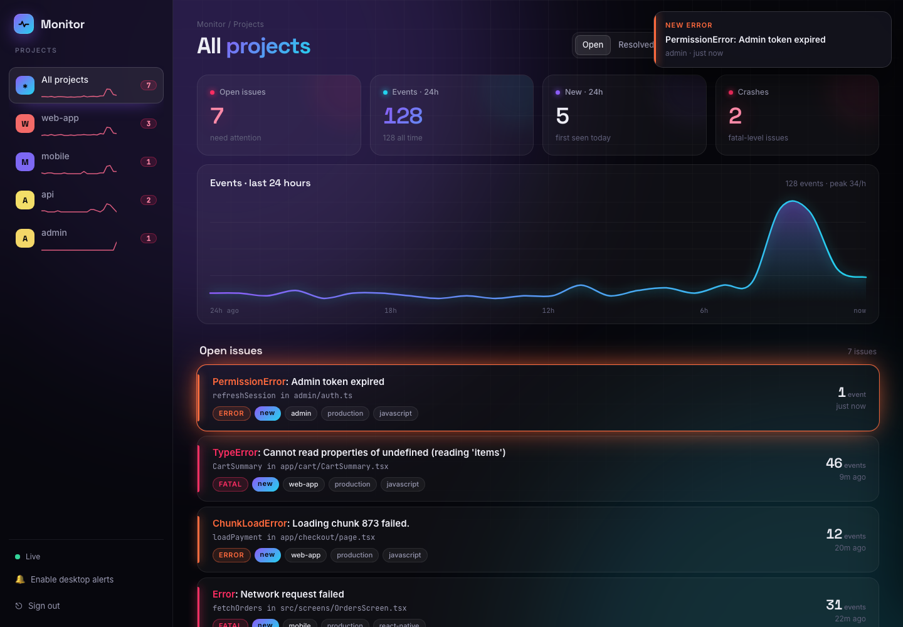
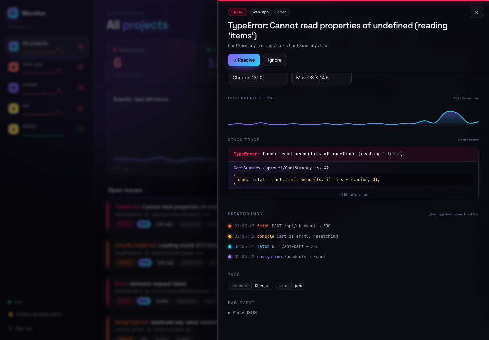
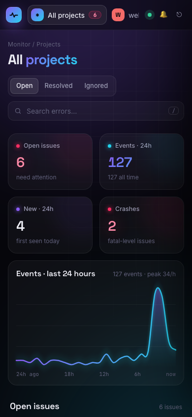
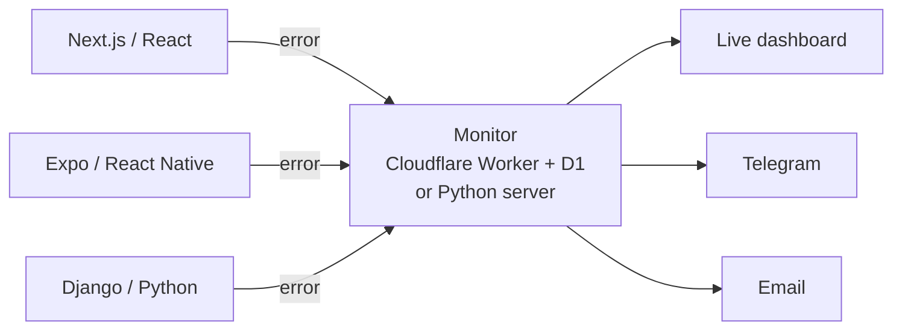

# Monitor

**Self-hosted error tracking: a free, open-source alternative to Sentry.**
Drop a tiny library into your Next.js, React, Expo / React Native, Node, Django or Python app. Every
crash lands on a live dashboard within seconds, grouped into issues, with the stack trace, the user,
the page and the steps that led to it. You get a phone alert the moment something new breaks.

Runs on **Cloudflare's free plan** (no server, no domain, no credit card), or on any machine with Python.



<table>
  <tr>
    <td></td>
    <td width="30%"></td>
  </tr>
</table>

## Features

- **Live dashboard**: projects sidebar with open counts and 24h sparklines, an events chart, search, and
  open / resolved / ignored tabs. New errors pop up as they happen. Works on phones too.
- **Issue details**: stack trace (your code highlighted, library frames folded), the error chain
  ("caused by"), breadcrumbs (console logs, fetch calls and page changes before the crash), user, URL,
  browser, OS, release, tags and the raw event.
- **Smart grouping**: the same bug is one issue with a counter, not 1,000 rows. Build hashes in bundle
  names are ignored, so a new deploy doesn't re-open every issue.
- **Alerts without the noise**: you're alerted only when an issue is **new**, or when a **resolved** one
  comes back. Telegram, email and desktop notifications.
- **Tiny libraries, no dependencies**: one JS file (browser, Next.js, Node, React Native) and one Python
  file (Python, Django). Each sends at most 30 events a minute, so an error inside a loop can't flood you.
- **Multiple projects** on one dashboard: one DSN per app.
- **Free to run**: the Cloudflare free plan allows 100,000 requests a day.

## How it works



Each app gets a **DSN**, an address with a key in it: `https://<KEY>@<your-monitor>/<project-id>`.
The library catches errors and posts them there.

---

## 1. Deploy (Cloudflare, about 5 minutes)

You need [Node.js 18+](https://nodejs.org) and a free [Cloudflare account](https://dash.cloudflare.com/sign-up)
(email only).

```sh
git clone https://github.com/SAGAR6311/monitor.git
cd monitor/cloudflare
./deploy.sh
```

The first run:
1. opens your browser to log in to Cloudflare,
2. asks you to pick a free `workers.dev` name (type a name like `yourname-monitor`, not "yes"),
3. creates the database, generates your keys and uploads everything.

It finishes with:

```
✅ Live.

  Dashboard : https://monitor.yourname-monitor.workers.dev/?token=…
  DSN       : https://<KEY>@monitor.yourname-monitor.workers.dev/<project id>
```

Your keys are saved in `cloudflare/.secrets` (never committed). Open the dashboard link once: the browser
remembers you.

> A brand-new `workers.dev` name can take a minute or two to get its HTTPS certificate. If the link
> fails right after deploying, wait a moment and reload.

**Name your projects** in `cloudflare/wrangler.toml`, then run `./deploy.sh` again:

```toml
MONITOR_PROJECTS = "1=shop-web,2=shop-app,3=shop-api"
```

**Update later:** `git pull && ./deploy.sh`. Your data and keys stay.

### Use your own domain (optional)

If your domain is on Cloudflare, add this near the top of `cloudflare/wrangler.toml` (above `[vars]`) and
redeploy:

```toml
routes = [{ pattern = "monitor.example.com", custom_domain = true }]
```

Your DSN becomes `https://<KEY>@monitor.example.com/<project id>`.

## 2. Alerts

| Channel | Setup |
|---|---|
| **Telegram** (phone, recommended) | In Telegram, open **@BotFather**, send `/newbot`, pick a name and copy the token. Run `cd cloudflare && ./telegram.sh`, paste the token, then press **Start** in your new bot. You'll get a test message. |
| **Email** | Sign up at [resend.com](https://resend.com) with the address you want alerts at, create an API key, run `npx wrangler secret put RESEND_API_KEY`, set `ALERT_EMAIL` in `wrangler.toml`, then `./deploy.sh`. |
| **Desktop** | On the dashboard, click **🔔 Enable desktop alerts**. Works while the dashboard is open, even in a background tab. |

You're alerted when an issue is **new**, or when a **resolved** issue happens again. Repeats of an open
issue only raise its counter.

## 3. Connect your apps

Each library is a single file. The simplest way to install it is to **copy the file into your project**,
which works everywhere (Vercel, EAS, Docker) without publishing anything.

| Your app | Copy this file |
|---|---|
| JavaScript / TypeScript | [`sdk-js/index.js`](sdk-js/index.js) (+ [`index.d.ts`](sdk-js/index.d.ts) for types) |
| Python / Django | [`sdk-python/monitor_sdk.py`](sdk-python/monitor_sdk.py) |

Use a different project id per app: `…/1`, `…/2`, `…/3`.

### Next.js (App Router, Next 13.4+), one command

From your Next.js project folder:

```sh
sh /path/to/monitor/sdk-js/setup-nextjs.sh
```

It works with TypeScript or JavaScript and with or without a `src/` folder, and it never overwrites your
files. It adds:

| File | Catches |
|---|---|
| `lib/monitor.js` | the library |
| `instrumentation.(ts\|js)` | server errors: pages, API routes, server actions |
| `components/MonitorInit` + one line in `app/layout` | browser errors: clicks, timers, promises |
| `app/error`, `app/global-error` | render crashes that React catches |
| `app/test-monitor/page` | a **Break it** button to test with. Delete it afterwards. |

On Next 14 it also turns on `experimental.instrumentationHook` in `next.config`. Then add your DSN to
`.env` (and to your hosting's environment variables) and restart:

```sh
MONITOR_DSN=https://<KEY>@monitor.yourname-monitor.workers.dev/1
NEXT_PUBLIC_MONITOR_DSN=https://<KEY>@monitor.yourname-monitor.workers.dev/1
```

### React, Vite or any website

```js
import { init } from "./lib/monitor";
init({ dsn: "https://<KEY>@<your-monitor>/1", environment: "production", release: "web@1.0.0" });
```

### Expo / React Native

```ts
// app/_layout.tsx (Expo Router) or App.tsx, as early as possible
import { Platform } from "react-native";
import { init } from "./lib/monitor";

init({
  dsn: "https://<KEY>@<your-monitor>/2",
  environment: __DEV__ ? "development" : "production",
  tags: { os: Platform.OS },
});
```

It catches JS errors and fatal crashes (the report gets up to 2s to send before the app closes), plus
unhandled promise rejections on Hermes (Expo's default engine). If you use an `ErrorBoundary`, call
`captureException(error)` in it.

### Node.js

```js
import { init } from "./lib/monitor.js";
init({ dsn: "https://<KEY>@<your-monitor>/3", environment: "production" });
```

It catches uncaught exceptions (it reports, then exits like Node normally would) and unhandled rejections.

### Django

```py
# settings.py (bottom)
import monitor_sdk
monitor_sdk.init("https://<KEY>@<your-monitor>/3", environment="production", release="api@1.0.0")
```

That's all: 500 errors (with URL, method and logged-in user), `logger.error(...)`,
`logger.exception(...)` and crashes in the main program and in threads are reported. It's safe with
gunicorn and uWSGI workers.

### Any Python app

```py
import monitor_sdk
monitor_sdk.init("https://<KEY>@<your-monitor>/4")
```

### Reporting errors yourself

Errors you catch with `try/catch` don't crash anything, so report the ones you care about:

| JavaScript | Python |
|---|---|
| `captureException(err)` | `monitor_sdk.capture_exception(exc)` (or no argument inside `except`) |
| `captureMessage("Payment API down", "error")` | `monitor_sdk.capture_message("Payment API down", "error")` |
| `setUser({ id, email })` / `setUser(null)` | `monitor_sdk.set_user({"id": …, "email": …})` |
| `setTag("plan", "pro")` | `monitor_sdk.set_tag("plan", "pro")` |
| `addBreadcrumb({ category: "auth", message: "logged in" })` | |
| `await flush()` | `monitor_sdk.flush()` |

`init()` options (JS): `dsn`, `environment`, `release`, `tags`, and
`beforeSend(event)`. Use `beforeSend` to edit an event or return `null` to drop it, e.g. to strip personal data.

---

## Self-hosting instead of Cloudflare

`server.py` is the same monitor as a small Python app (FastAPI + SQLite). It also streams updates to the
dashboard instantly and sends email over SMTP (e.g. Gmail).

```sh
./setup.sh     # creates .venv and .env with random MONITOR_TOKEN / MONITOR_KEY
./start.sh     # prints your dashboard link and DSN
```

Settings live in `.env`:

| Setting | Meaning |
|---|---|
| `MONITOR_TOKEN` | dashboard password |
| `MONITOR_KEY` | key inside your DSNs |
| `MONITOR_PROJECTS` | names for project ids, e.g. `1=web,2=mobile` |
| `MONITOR_HOST` / `MONITOR_PORT` | listen address. Keep `127.0.0.1` behind a reverse proxy. |
| `PUBLIC_URL` | your public address, used for links in emails |
| `ALERT_EMAIL`, `SMTP_HOST`, `SMTP_PORT`, `SMTP_USER`, `SMTP_PASSWORD` | email alerts. For Gmail, use an [App Password](https://myaccount.google.com/apppasswords). |

Put it behind HTTPS so live apps can reach it, for example with:
- a free [Oracle Cloud Always Free](https://www.oracle.com/cloud/free/) VM + [Caddy](https://caddyserver.com)
  (`<ip-with-dashes>.sslip.io` gives you a free HTTPS name with no domain), or
- a [Cloudflare Tunnel](https://developers.cloudflare.com/cloudflare-one/connections/connect-networks/)
  from your own machine.

The self-hosted server also accepts events from the **official Sentry SDKs** (envelope and store
endpoints, including gzip and brotli), so existing Sentry setups can switch just by changing the DSN.

## Security

- **Dashboard token** (`MONITOR_TOKEN`): this is your password. Keep it secret.
- **DSN key** (`MONITOR_KEY`): it ships inside your frontend bundles, so treat it as public. It can only
  *send* events, not read them. If someone abuses it, rotate it:
  `npx wrangler secret put MONITOR_KEY`, then update your DSNs.
- The dashboard renders all event data as text, never HTML, so a malicious error message can't run
  script in your browser.
- Events are capped at 1 MB on Cloudflare and 5 MB on the self-hosted server. The last 50 events per issue
  are kept.

## API

| Method | Path | Auth | |
|---|---|---|---|
| `POST` | `/ingest/<project>` | `?key=` | send one event (JSON) |
| `GET` | `/d/overview` | `?token=` | per-project counts and 24h hourly events |
| `GET` | `/d/issues?status=unresolved\|resolved\|ignored` | `?token=` | issue list |
| `GET` | `/d/issues/<id>` | `?token=` | issue + latest event + recent timestamps |
| `POST` | `/d/issues/<id>/<status>` | `?token=` | resolve / ignore / reopen |
| `GET` | `/d/stream` | `?token=` | live updates (server-sent events), self-hosted only |

Events use Sentry's event JSON shape (`exception.values[].stacktrace.frames`, `message`, `level`, `user`,
`request`, `tags`, `breadcrumbs`, `contexts`, `fingerprint`, …).

## Project structure

```
monitor/
├── dashboard.html          the dashboard (one file, used by both servers)
├── server.py               self-hosted server (FastAPI + SQLite)
├── setup.sh, start.sh      self-hosted setup / start
├── check.py                self-check: python check.py
├── cloudflare/
│   ├── src/index.js        Cloudflare Worker (same API as server.py)
│   ├── schema.sql          D1 database tables
│   ├── wrangler.example.toml
│   ├── deploy.sh           deploy / update
│   └── telegram.sh         connect Telegram alerts
├── sdk-js/
│   ├── index.js, index.d.ts   JS library (browser, Next.js, Node, React Native)
│   └── setup-nextjs.sh        one-command Next.js setup
└── sdk-python/
    └── monitor_sdk.py      Python library (Python, Django)
```

## Troubleshooting

| Problem | Fix |
|---|---|
| `Subdomain is unavailable` during deploy | You typed `y`/`yes` as the name. Type a unique name like `yourname-monitor`. |
| Dashboard link fails right after the first deploy | A new `workers.dev` HTTPS certificate takes a minute or two. Wait and reload. |
| Nothing shows up | Check the DSN (key, address, project id). Restart your dev server after editing `.env`. Look for errors in the browser console. |
| Next.js: `Cannot find module '@/lib/monitor'` | Use a relative import such as `../lib/monitor`, or set up the `@/` alias. |
| Next.js 14: server errors missing | Make sure `experimental: { instrumentationHook: true }` is in `next.config`. The setup script adds it. |
| Production JS stack traces show minified names | Source maps aren't supported yet. Errors are still grouped and reported. |

## Limitations

- No source-map upload yet (minified frames in production JS).
- No native iOS/Android crash capture (only JavaScript errors in React Native).
- No performance tracing or session replay.
- The Cloudflare dashboard refreshes every 5 seconds, while the self-hosted one updates instantly.

## Contributing

Issues and pull requests are welcome. Run `python check.py` (with the deps from `requirements.txt`) before
sending changes, and keep both servers' APIs in sync (`server.py` and `cloudflare/src/index.js`).

## License

[MIT](LICENSE)
